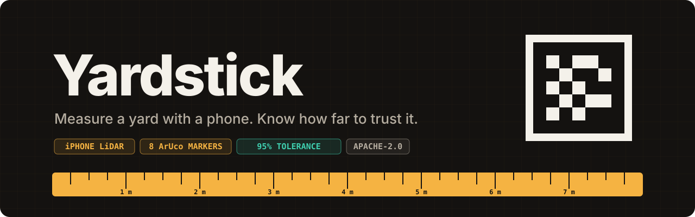
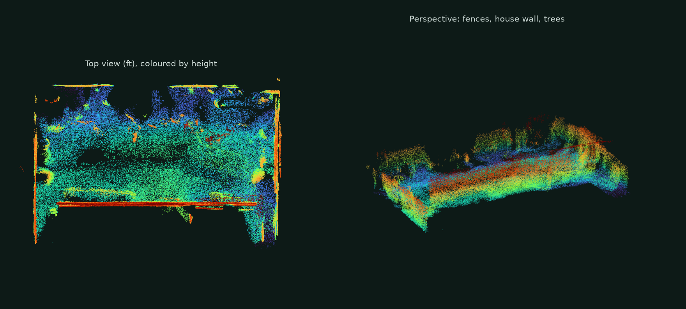
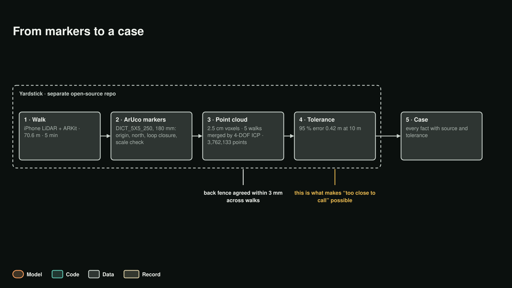

<!--
Copyright 2026 Martin Fabbri

Licensed under the Apache License, Version 2.0 (the "License");
you may not use this file except in compliance with the License.
You may obtain a copy of the License at

    http://www.apache.org/licenses/LICENSE-2.0

Unless required by applicable law or agreed to in writing, software
distributed under the License is distributed on an "AS IS" BASIS,
WITHOUT WARRANTIES OR CONDITIONS OF ANY KIND, either express or implied.
See the License for the specific language governing permissions and
limitations under the License.
-->

<p align="center">
  
</p>

<p align="center">
  <b>Walk a yard with an iPhone and a few printed markers. Yardstick turns the walk into a metric 3D scan of the lot,
  and tells you how far each measurement can be trusted: a 95 % error bar, derived from the walk itself.</b>
</p>

<p align="center">
  iOS app (Swift 6, ARKit, LiDAR) · laptop toolkit (Python) · open contract <code>yardstick-capture/1</code> ·
  Apache-2.0
</p>

---

> [!NOTE]
> Yardstick is the capture tool behind **[LotFit](https://github.com/martin-fabbri/lotfit)**, which reads a city's
> zoning code against the scanned yard and answers whether a backyard cottage fits. Yardstick is a **separate
> project and is not part of the LotFit hackathon entry**: LotFit accepts any capture that meets the published
> contract in [`contract/`](contract/), and Yardstick is one such source.

## Why

A tape measure is exact, but nobody tapes a whole lot. A satellite photo shows the lot, but not to the foot, and not
the fence that is two feet off the record. A phone with LiDAR sees everything, but drifts as you walk, and an app
that hides that drift gives numbers you can't defend.

Yardstick takes the phone scan and keeps it honest. Printed markers pin the scan to the ground, fix its scale and
measure its drift; every capture comes out with **its own error bar at every range**. A downstream tool can then
say "this fits", "this doesn't", or, when the margin is smaller than the error, **"too close to call: tape this
one"**.

## What one capture gives you

<p align="center"></p>

Reference walk and lot (figures from LotFit's [capture write-up](https://github.com/martin-fabbri/lotfit/blob/main/docs/capture.md)):

| | |
|---|---|
| One walk | 5 min 8 s · 70.6 m walked · 9,215 depth frames · 216 keyframes · 87 marker sightings |
| One walk's cloud | 4,088,022 points over 122.8 m² of scanned ground (2.5 cm voxels) |
| Scale check | 71 close sightings measured the printed 180 mm marker at 174.1–184.5 mm |
| Five walks merged | 3,762,133 points (2 cm voxels); back fence agrees across walks within **3 mm** |
| Against the county record | fence to fence **19.49 m** scanned vs **19.47 m** recorded (within 0.1 %) |
| The error bar | **0.42 m (1.38 ft) at 10 m**, 95 %, computed from that walk's own scale error and drift |
| Where the record was wrong | house rear wall to rear lot line: **+1.91 m** against the record, more than both tolerances together |

The image above is the merged demo lot (200,000 of its points), coloured by height: fences, the house wall, trees.

## How it works

<p align="center"></p>

**1. The walk (iPhone).** ARKit world tracking with gravity alignment records colour video (1920×1440, 30 fps), LiDAR
depth on a 256×192 grid with per-pixel confidence, every frame's camera pose and intrinsics, high-resolution stills,
compass samples for north, and audio, all on one monotonic clock. Nothing is interpreted on the phone and nothing is
silently flipped; every file is sealed with SHA-256 in `manifest.json`.

**2. The markers.** Eight printed ArUco markers (OpenCV `DICT_5X5_250`, IDs 0–7, 180 mm on matte foam board) are
tossed two or three big steps apart. Marker 0 is the origin and the loop-closure point. A clean-room detector on the
phone reads them live at 5–10 Hz, refines each pose with the LiDAR plane inside the marker, and, whenever two markers
are in the same frame (0.5–4.2 m), measures their displacement directly in that one frame: a measurement with no
accumulated tracking drift. On the laptop a weighted Gauss-Newton solver (Huber IRLS) builds the marker layout from
those pairs, corrects scale from the printed size, and warps the trajectory and cloud onto the solved layout. The
raw, unwarped scan is always kept alongside.

**3. The cloud.** Depth frames with confidence ≥ 1 and range 0.20–4.50 m are placed in the yard frame (origin at
marker 0, +Z against gravity, ground at z = 0, north calibrated at marker 0) and averaged into voxels; the ground
plane is fitted with RANSAC.

**4. The error bar.** Every capture is graded with a closed-form 95 % tolerance at range *r*:

```
tol(r) = max( tape_floor(r),
              1.96 · sqrt( σ_lidar² + (scale_error · r)² + (loop_gap / walk_length · r)² + σ_tracking² ) )
```

σ_lidar = 1.5 cm; the scale error is what the markers measured (minus twice its standard error); the loop gap is
how far the walk ended from where it started on marker 0; σ_tracking grows with the share of frames where ARKit
reported limited tracking. An optional tape check sets a floor, and held-out tape checks test the formula without
ever being used to adjust a point (`YS-43`). The formula, its inputs and the grade travel in `grade.json`.

| Grade | 95 % error at 10 m | Marker 0 loop gap | Evidence |
|---|---|---|---|
| **A** | ≤ 5 cm | ≤ 5 cm | start and end on marker 0, one tape check, clean integrity |
| **B** | ≤ 10 cm | ≤ 12 cm | same, warnings allowed |
| **C** | ≤ 20 cm | ≤ 25 cm | any valid capture (also the cap when marker 0, loop closure or tape is missing) |
| **fail** | above | above | or integrity `partial` / `invalid` |

The full math, coordinate frames and caps are in [`docs/DESIGN.md`](docs/DESIGN.md).

## The contract: `yardstick-capture/1`

Two levels, connected by a hash-sealed archive. JSON Schema (Draft 2020-12) for every file is in
[`contract/`](contract/).

| Level | Written by | Files |
|---|---|---|
| **1 · Recording** | the iPhone | `session.json`, `manifest.json`, `poses.csv`, `frames.csv`, `markers.csv`, `pairs.csv`, `events.csv`, `rgb.mp4`, `depth/`, `confidence/`, `stills/`, `audio.wav` |
| **2 · Standard capture** | the laptop toolkit | `standard/capture.json`, `frame.json`, `trajectory.json` (+ `.raw`), `cloud.ply` (+ `.raw`), `keyframes.json`, `coverage.json`, `grade.json` |

Any tool that writes a valid Level 2 capture can feed LotFit; any tool that reads one gets the geometry *and* its
error bars.

## Quick start

**Print the markers** (one tabloid page per ID, with a 100 mm check bar; `--verify` decodes every page):

```bash
uv run --with opencv-contrib-python-headless --with pymupdf --with reportlab --with numpy \
  python toolkit/scripts/make_marker_sheets.py --ids 0 1 2 3 4 5 6 7 --out markers.pdf --verify
```

**Run the toolkit** (Python 3.12+, [`uv`](https://github.com/astral-sh/uv)):

```bash
cd toolkit
uv run --extra dev pytest                     # 43 tests
uv run yardstick synth --output /tmp/test-walk  # a deterministic synthetic yard
uv run yardstick validate /tmp/test-walk
uv run yardstick convert /tmp/test-walk
uv run yardstick grade /tmp/test-walk
```

Also `yardstick unpack` (a capture `.zip`, hashes verified) and `yardstick pack`.

**Walk a yard:**
1. Toss the eight markers two or three big steps apart, marker 0 where you start. Never move one during the walk.
2. Start the walk on marker 0; north locks there.
3. Stroll at chest height, 1.5–3.5 m from fences and walls. The app shows every marker it has seen and coaches you
   when two are too far apart to fit in one frame.
4. Come back to marker 0, see the loop-closure gap and the provisional grade, tap **Finish**, export the `.zip`.

<details>
<summary><b>Install the iPhone app over a USB cable (free Apple ID)</b></summary>

Needs a Mac with Xcode 16+ and an iPhone with LiDAR (Pro models).

1. `git clone https://github.com/martin-fabbri/yardstick.git`
2. Xcode → **Settings** → **Accounts** → `+` → **Apple ID** (a free account creates a *Personal Team*).
3. Open `ios/Yardstick/Yardstick.xcodeproj` → target **Yardstick** → **Signing & Capabilities**: automatic signing,
   your Personal Team, and a unique bundle identifier (e.g. `io.buildnexus.yardstick.yourname`).
4. On the iPhone, first time only: connect by cable, **Trust This Computer**, then **Settings → Privacy & Security →
   Developer Mode** on, restart.
5. Select the iPhone as the run destination and press **Run** (`Cmd + R`).
6. First launch: **Settings → General → VPN & Device Management** → trust your Apple ID.

A free signature lasts 7 days; reconnect and press **Run** again to refresh it. Recordings on the phone are kept.
</details>

## Tests

- Toolkit: 43 tests (`uv run --extra dev pytest`), including a synthetic yard with known geometry.
- iOS: 39 XCTests; the phone's grade is a line-for-line port of the toolkit's, checked against shared vectors
  (`toolkit/tests/fixtures/grade_parity_vectors.json`).
- Field replays: recorded walks re-run through the app's logic (an 8-marker walk locks all 8 and finishes).

## Repository

```
contract/   JSON Schema for yardstick-capture/1 (session, manifest, frame, keyframes, trajectory, coverage, events, grade, visit)
ios/        the iPhone app (Swift 6 / SwiftUI, ARKit, Vision, no third-party packages)
toolkit/    the laptop toolkit: validate, convert, grade, synth, pack/unpack; marker sheet generator
docs/       DESIGN.md (architecture, frames, math, contract), PLAN.md (build plan)
```

## Clean room and licences

- **Clean-room implementation.** The iOS app and the toolkit are written from our own requirements and platform
  documentation alone. No code, file layouts or text were read, copied or ported from any other capture
  application. Yardstick was built with a non-Meta coding agent.
- **ArUco dictionary.** The `DICT_5X5_250` bit patterns are generated by `toolkit/scripts/generate_aruco_dict.py`
  from OpenCV's published definition (Apache-2.0). Detection, homography and LiDAR plane refinement are original work.

| Component | Package | Licence |
|---|---|---|
| Repository and code | `martin-fabbri/yardstick` | Apache-2.0 |
| iOS app | Apple SDK (ARKit, AVFoundation, CoreLocation, Vision, Accelerate, CryptoKit) | Apple SDK agreement |
| ArUco bit table | generated from OpenCV `DICT_5X5_250` | Apache-2.0 |
| Toolkit | numpy, scipy | BSD-3-Clause |
| Toolkit | opencv-contrib-python-headless | Apache-2.0 |
| Toolkit | Pillow | MIT-CMU |
| Toolkit | jsonschema, pydantic, pytest | MIT |
